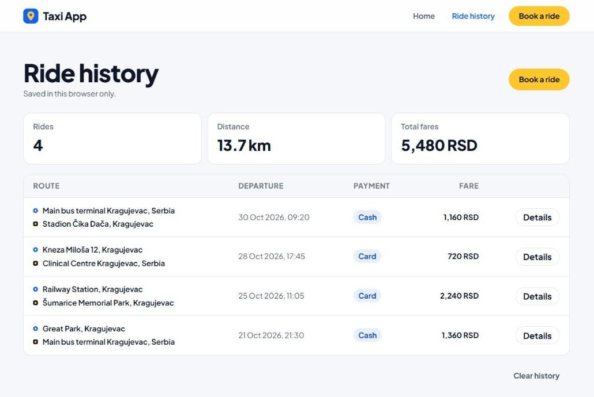
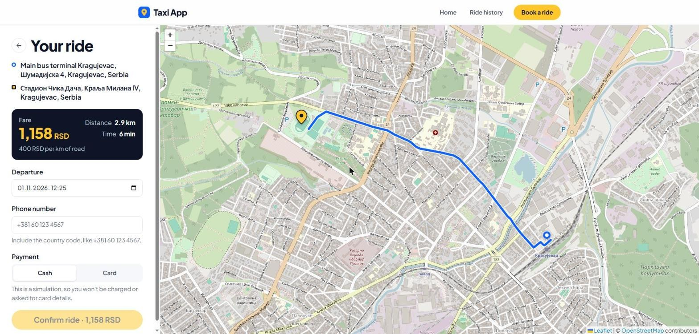
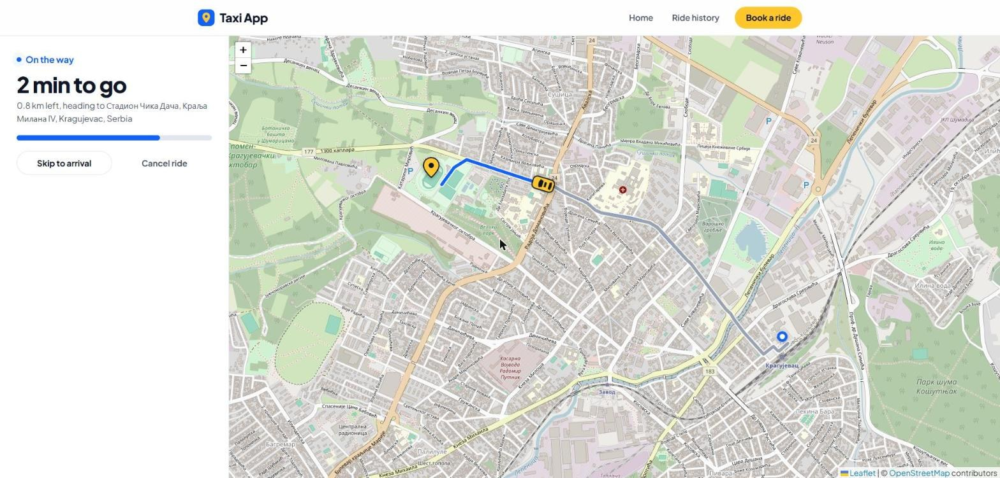
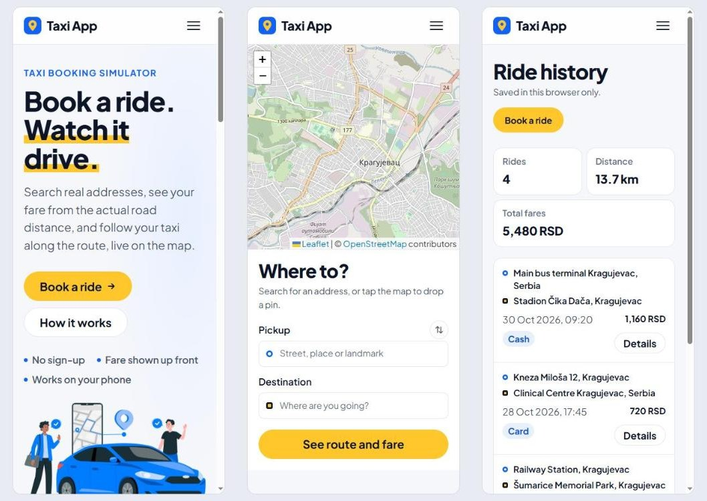

# 🚕 Taxi App

[](https://angular.io/)
[](https://leafletjs.com/)
[](https://render.com/)

A taxi booking simulator built with Angular and Leaflet. Search real addresses, see the fare for the actual road route, then follow your taxi along it on the map. No real cars or payments are involved.

**Live demo: https://taxi-app-fhpm.onrender.com**

## Screenshots

The ride history below uses sample rides.

| Landing page | Ride history |
| --- | --- |
|  |  |

| Route and fare | Ride in progress |
| --- | --- |
|  |  |

**On a phone**



## Features

- **Address search and map pins**: suggestions as you type, or tap the map to choose a spot
- **Road routing**: distance, time and fare come from the real route, at 400 RSD per km
- **Live ride simulation**: the taxi follows the route with progress and time remaining; trips play back in 12 to 45 seconds
- **Ride history**: totals, ride details and pagination, stored in the browser's local storage
- **Responsive and accessible**: works on phones, supports keyboard use and respects reduced-motion settings

The app never asks for card details. Choosing Cash or Card only labels the ride, and card data saved by older versions is erased the next time the history loads.

## Getting started

You need Node.js 18 (see `.nvmrc`).

```bash
git clone https://github.com/IgorPavlov00/Taxi-App.git
cd Taxi-App
npm ci
npm start
```

Then open http://localhost:4200.

| Command | What it does |
| --- | --- |
| `npm start` | Runs the development server |
| `npm run build` | Creates a production build in `dist/untitled1` |
| `npm test` | Runs the unit tests |

## Deploying to Render

`render.yaml` defines a static site, including the rewrite that lets routes like `/map` load directly.

1. In Render, choose **New > Blueprint** and connect this repository.
2. Select the branch to deploy and apply the Blueprint.

If you connect the repository through your GitHub account, Render also redeploys on every push to that branch. If you use the public repository URL instead, trigger each deploy from the Render dashboard.

## Map services

The app calls these free public services directly from the browser, with no API keys:

| Purpose | Service |
| --- | --- |
| Map tiles | [OpenStreetMap](https://www.openstreetmap.org/copyright) |
| Address search | [Photon](https://photon.komoot.io) |
| Routing | [OSRM demo server](https://project-osrm.org) |

They are fine for a demo, but they have usage limits and no uptime guarantee. An app with real traffic should move to a paid or self-hosted provider.
